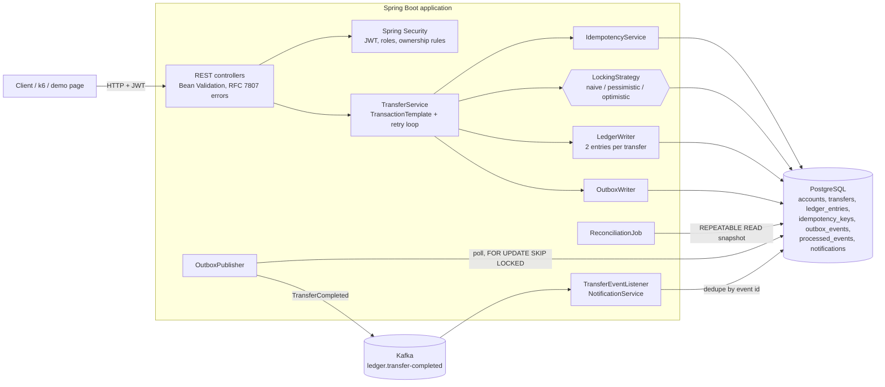

# Payments Ledger

A wallet/ledger backend in **Java 21 + Spring Boot 4**: INR wallets, transfers and deposits,
and a **double-entry ledger**, a simplified version of what a payments company runs
internally. The point of the project is **correctness under concurrency and retries**, proven
with tests, load tests and a live race demo.

- Three interchangeable concurrency strategies (`naive` / `pessimistic` / `optimistic`). The
  naive one exists to show the lost-update bug; tests prove it breaks the ledger and the
  other two don't.
- `Idempotency-Key` on every money-moving request, enforced by a database constraint.
  Concurrent duplicates produce exactly one transfer.
- JWT security with ownership rules, scheduled reconciliation, Micrometer metrics, request-id
  log correlation.
- Transactional outbox to Kafka with an idempotent consumer. Kafka is optional (`core` profile).
- k6 load tests across all strategies, with results checked for drift and duplicates.

**Reading the code:** the classes are commented to explain *why*, not just *what*. A good order:
`TransferService` → `transfer/locking/` → `IdempotencyService` → `SecurityConfig` →
`ReconciliationService` → `outbox/`.

## Architecture



One transfer is **one database transaction**: claim the Idempotency-Key, then load/lock both
accounts, then debit and credit, then insert the transfer row, the two ledger entries and the
outbox event, then store the response. Everything after the commit (Kafka, notifications) is
asynchronous and can't affect the money.

## The invariants

| # | Invariant | Enforced by | Proven by |
|---|---|---|---|
| 1 | Every completed transfer has exactly two ledger entries that sum to zero | `LedgerWriter`, `UNIQUE(transfer_id, account_id)`, single transaction | `LedgerInvariantsTest`, reconciliation |
| 2 | No balance goes negative, except the system funding account | `Account.debit`, `CHECK (kind = 'FUNDING' OR balance_paise >= 0)` | `AccountTest`, `TransferApiTest`, concurrency tests |
| 3 | The sum of all ledger entries is 0 | double entry, append-only trigger | every integration test (`LedgerInvariants`), reconciliation |
| 4 | Each account's stored balance equals the sum of its ledger entries | locking strategy (pessimistic/optimistic) | `LockingStrategyConcurrencyTest` (naive **breaks** it), reconciliation |
| 5 | A retried request with the same Idempotency-Key never moves money twice | `idempotency_keys` PK + `UNIQUE(transfers.idempotency_key)` | `ConcurrentIdempotencyTest`, retry-storm load test |

## Run it

Requirements: **JDK 21** and **Docker**. Nothing else; the Maven wrapper downloads Maven.

```bash
./mvnw test                                   # full suite: Testcontainers starts PostgreSQL and Kafka
```

```bash
docker compose up --build                     # app + PostgreSQL + Kafka, demo profile on
```

```bash
docker compose -f docker-compose.core.yml up --build   # app + PostgreSQL only (no Kafka)
```

Then open <http://localhost:8080/swagger-ui.html> or <http://localhost:8080/demo.html>. If ports
8080/5432 are taken, prefix the command with `LEDGER_HTTP_PORT=18080 LEDGER_DB_PORT=15432`.
To pick a locking strategy, set `LEDGER_LOCKING=naive|pessimistic|optimistic`.

The local admin (from the compose files) is `admin@ledger.local` / `admin-password-local`.

## API walkthrough (curl)

The walkthrough uses `jq` to pull fields out of JSON responses.

```bash
BASE=http://localhost:8080
JSON='Content-Type: application/json'

# Two users, each with a wallet (the owner of a new account is always the caller)
for who in asha bob; do
  curl -s -X POST $BASE/api/auth/register -H "$JSON" \
    -d "{\"fullName\":\"$who\",\"email\":\"$who@example.com\",\"password\":\"$who-password\"}" > /dev/null
done
ASHA=$(curl -s -X POST $BASE/api/auth/login -H "$JSON" -d '{"email":"asha@example.com","password":"asha-password"}' | jq -r .accessToken)
BOB=$(curl -s -X POST $BASE/api/auth/login -H "$JSON" -d '{"email":"bob@example.com","password":"bob-password"}' | jq -r .accessToken)
ASHA_ACC=$(curl -s -X POST $BASE/api/accounts -H "Authorization: Bearer $ASHA" | jq .id)
BOB_ACC=$(curl -s -X POST $BASE/api/accounts -H "Authorization: Bearer $BOB" | jq .id)

# Deposits are ADMIN-only; amounts are integer paise (50000 = ₹500.00)
ADMIN=$(curl -s -X POST $BASE/api/auth/login -H "$JSON" \
  -d '{"email":"admin@ledger.local","password":"admin-password-local"}' | jq -r .accessToken)
curl -s -X POST $BASE/api/deposits -H "Authorization: Bearer $ADMIN" -H "$JSON" \
  -H 'Idempotency-Key: dep-0001' -d "{\"accountId\":$ASHA_ACC,\"amountPaise\":50000}"

# Transfer. Run it twice: the second response is the stored one (Idempotent-Replayed: true)
curl -si -X POST $BASE/api/transfers -H "Authorization: Bearer $ASHA" -H "$JSON" \
  -H 'Idempotency-Key: tx-0001' -d "{\"fromAccountId\":$ASHA_ACC,\"toAccountId\":$BOB_ACC,\"amountPaise\":1500}"

# Balance + 20 most recent ledger entries; transfer history
curl -s $BASE/api/accounts/$ASHA_ACC -H "Authorization: Bearer $ASHA" | jq
curl -s "$BASE/api/transfers?size=20" -H "Authorization: Bearer $ASHA" | jq

# Bob cannot read Asha's wallet (403) or move money out of it (403)
curl -s $BASE/api/accounts/$ASHA_ACC -H "Authorization: Bearer $BOB" | jq .code

# Reconciliation (ADMIN): checks invariants 1-4 across every account
curl -s -X POST $BASE/api/admin/reconciliation/runs -H "Authorization: Bearer $ADMIN" | jq
```

Errors are RFC 7807 problem details with a stable `code` and the `requestId` from the logs:
```json
{"type":"/problems/insufficient-funds","title":"Insufficient funds","status":422,
 "detail":"Account 2 has 500 paise, cannot debit 900 paise","code":"INSUFFICIENT_FUNDS","requestId":"3f1c..."}
```

## Load-test results

Produced by `python loadtest/run_all.py`; raw k6 summaries and every derived number are in
`loadtest/results/`. Each row is a fresh stack; the last two columns must be 0.

Run started 2026-11-20 15:21 UTC, git commit `dd0c856`, 60s per scenario.
- **Host:** AMD Ryzen 7 5800H with Radeon Graphics, 16 logical CPUs, 15.4 GB RAM, Windows-11-10.0.26200-SP0
- **Docker:** 29.9.3 (Docker Desktop), 16 CPUs / 7.5 GB available to containers
- **Limits:** app: 4 CPUs / 2 GB, postgres: 4 CPUs / 2 GB, k6: unlimited (same machine)
- **Load generator:** k6 v2.4.0 (commit/dd9395906d, go1.27.3, linux/amd64)

| Mode | Scenario | VUs | Transfer req/s | OK transfers/s | p50 ms | p95 ms | p99 ms | Transfer error rate | 409 | 5xx | Optimistic retries | Drifted accounts | Abs. drift (₹) | Ledger sum | DB rows − OK transfers | Duplicate ids seen |
|---|---|---|---|---|---|---|---|---|---|---|---|---|---|---|---|---|
| naive | hot-accounts | 32 | 235.5 | 235.5 | 81.59 | 422.52 | 695.53 | 0.00% | 0 | 0 | 0 | 5 | 1,890.85 | 0 | 0 | 0 |
| naive | retry-storm | 32 | 976.1 | 488.1 | 43.84 | 139.54 | 216.93 | 0.00% | 0 | 0 | 0 | 20 | 3,031.94 | 0 | 0 | 0 |
| naive | mixed | 64 | 360.6 | 308.8 | 89.87 | 190.31 | 264.96 | 0.00% | 0 | 0 | 0 | 195 | 25,370.94 | 0 | 0 | 0 |
| pessimistic | hot-accounts | 32 | 272.4 | 272.4 | 69.9 | 290.35 | 364.3 | 0.00% | 0 | 0 | 0 | 0 | 0.00 | 0 | 0 | 0 |
| pessimistic | retry-storm | 32 | 906.7 | 453.3 | 49.33 | 155.57 | 220.44 | 0.00% | 0 | 0 | 0 | 0 | 0.00 | 0 | 0 | 0 |
| pessimistic | mixed | 64 | 362.3 | 308.9 | 90.71 | 188.41 | 219.85 | 0.00% | 0 | 0 | 0 | 0 | 0.00 | 0 | 0 | 0 |
| optimistic | hot-accounts | 32 | 255.9 | 213.9 | 45.47 | 407.86 | 514.31 | 16.39% | 2516 | 0 | 59166 | 0 | 0.00 | 0 | 0 | 0 |
| optimistic | retry-storm | 32 | 660.5 | 329.8 | 72.57 | 276.35 | 506.91 | 0.19% | 74 | 0 | 38721 | 0 | 0.00 | 0 | 0 | 0 |
| optimistic | mixed | 64 | 329.6 | 282.7 | 93.82 | 198.94 | 287.75 | 0.00% | 0 | 0 | 2107 | 0 | 0.00 | 0 | 0 | 0 |

The short version: **naive corrupted balances in every scenario** (195 of 200 wallets even in
low-contention mixed traffic) and was not reliably faster: it beat pessimistic on hot accounts in
one run and lost in the next. **Pessimistic** had the best hot-account throughput with zero
errors, so it is the default. **Optimistic** stayed correct but gave up (409) on 16.4% of
hot-account transfers. Idempotency held everywhere: zero duplicate transfers under the retry storm.

## Race demo

Run it locally with `docker compose up --build`, then open <http://localhost:8080/demo.html>.
Pick a strategy and N, press **Run race**, and watch naive mode change the total amount of money
while pessimistic and optimistic conserve it.

To put it on the internet, follow [docs/DEPLOY.md](docs/DEPLOY.md) (Render, `core,demo`
profiles, managed PostgreSQL). The demo is then at `https://<your-service>.onrender.com/demo.html`.

## Project layout

```
src/main/java/com/example/ledger/
  account/         wallets, balance, debit/credit rules
  transfer/        TransferService (transaction + retries), controllers, metrics
  transfer/locking naive / pessimistic / optimistic strategies
  ledger/          ledger entries (append-only), LedgerWriter
  idempotency/     Idempotency-Key storage and replay
  security/        JWT, BCrypt, URL rules, AccessPolicy (ownership)
  reconciliation/  invariant checks, scheduled job, admin endpoint
  observability/   request-id filter
  outbox/          transactional outbox, Kafka publisher
  notification/    idempotent Kafka consumer
  demo/            race demo (demo profile only)
src/main/resources/db/migration/   Flyway V1..V5
loadtest/          k6 scenarios, runner, raw k6 results
docs/              DEPLOY.md
```

## Tech
Java 21 · Spring Boot 4.2 (Web MVC, Data JPA/Hibernate 7, Validation, Security + OAuth2 resource
server, Actuator) · PostgreSQL 18 · Flyway · Kafka 4.4 (Spring Kafka) · springdoc-openapi ·
Micrometer + Prometheus · JUnit 5 + Testcontainers · k6 · Docker / Compose · GitHub Actions.
